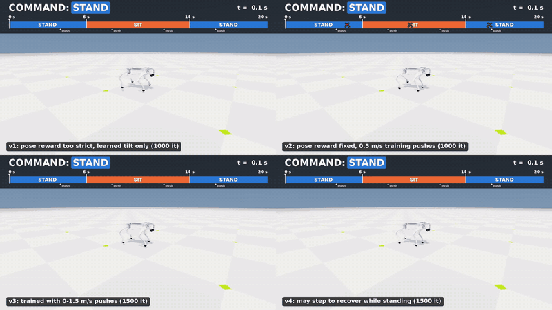
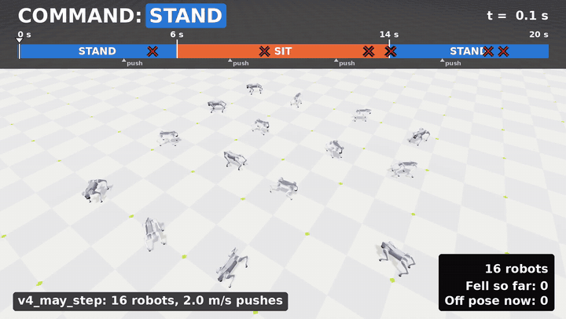
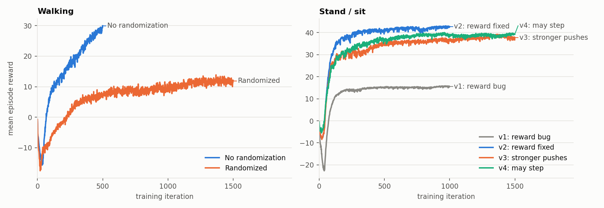
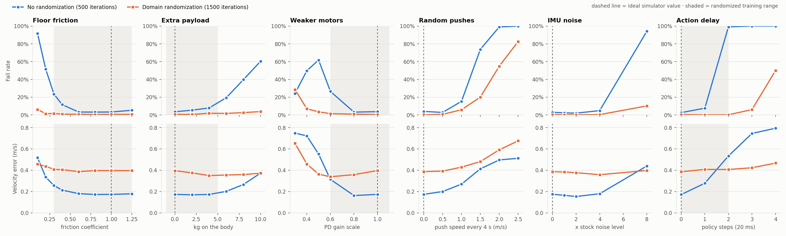
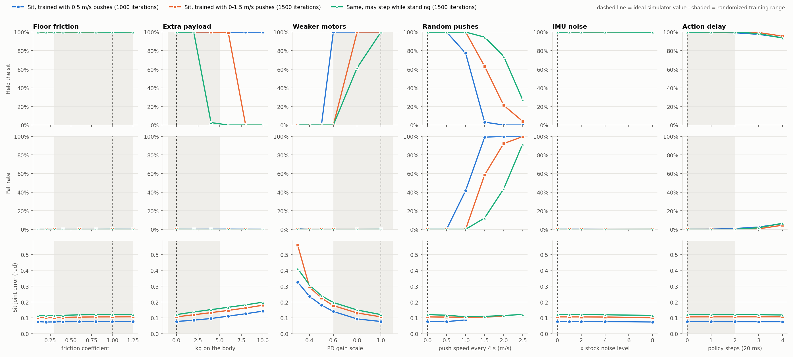

# AIPI 591: Challenge 3: Sim-to-Real for the Unitree Go2

### Author: Matana Pornluanprasert

This project trains a simulated Unitree Go2 robot dog with PPO to walk, to sit and stand on command, and to recover from hard pushes. It then estimates the sim-to-real gap without a physical robot: each policy is tested in 36 deliberately changed "fake real" simulated worlds.

The largest gap is action delay. A walking policy trained in an ideal simulator fell in 99% of episodes with 40 ms of delay, while a policy trained with domain randomization fell in 0.2%. Randomization has a price: in the normal world, walking speed error rose from 0.17 to about 0.40 m/s. For the stand/sit task, one change to the reward cut falls under 2 m/s pushes from 92% to 43%.

**No policy here has run on a real robot.** The results show how the policies react to differences I thought of and could simulate. They do not measure the true sim-to-real gap.

| Four training versions, same test (1.5 m/s pushes) | Final version, 16 robots (2 m/s pushes) |
|---|---|
|  |  |

Full-quality videos: [four versions](results/progress/push_1.5/sit_progress_2x2.mp4), [16 robots](results/progress/crowd_v4_may_step/videos/push_2.0/annotated.mp4).

# The Task

A legged robot must follow commands and stay up, even when the world is not what it expected. Floors differ, motors weaken, sensors are noisy, commands arrive late, and people bump into it. A policy that only works in a perfect simulator is not useful.

The robot learns two skills:

- **Walking:** follow a commanded forward, sideways and turning speed.
- **Stand and sit:** switch between two poses on a binary command (0 = stand, 1 = sit), and stay up when pushed.

# Tools and Simulation Platform

| Part | Tool |
|---|---|
| Robot | Unitree Go2, 12 joints (simulated model) |
| Framework | Isaac Lab 3, commit `e3a79743e` |
| Physics | Newton with the MuJoCo Warp solver (`physics=newton_mjwarp`), not standalone MuJoCo |
| RL library | RSL-RL (PPO) |
| Hardware | NVIDIA RTX 5060 Ti (16 GB), WSL Ubuntu 24.04 |
| Speed | about 240,000 simulation steps per second with 4,096 robots |

# Problem Formulation (MDP)

| | Walking | Stand / sit |
|---|---|---|
| **State (observation)** | 45 numbers | 43 numbers |
| **Action** | 12 joint targets | 12 joint targets |
| **Transition** | Physics simulator at 200 Hz, unknown to the policy (model-free) | Same |
| **Episode end** | Body touches the ground (fall), or 20 s | Same |
| **Reward** | Stock Isaac Lab Go2 velocity-tracking reward | Custom pose reward (below) |

**State space (continuous).** The policy only sees what a real Go2 can sense. The stock task also gives the true body velocity, but a real robot cannot measure it directly, so I removed it.

| Input | Size |
|---|---:|
| Body angular velocity (IMU) | 3 |
| Gravity direction in the body frame | 3 |
| Joint positions | 12 |
| Joint velocities | 12 |
| Last action | 12 |
| Command: velocity (walking) or stand/sit mode | 3 or 1 |

**Action space (continuous).** Twelve joint position offsets from the default pose, sent at 50 Hz with an action scale of 0.25. A PD controller (kp 25, kd 0.5) through the Go2 DC-motor model turns them into torque. Delay, when enabled, is applied here: the action runs 0 to 2 policy steps late (20 ms each), and the delay is drawn per robot at each reset.

**Sit pose.** It comes from the Go2's geometry and stays inside the soft joint limits. The body is pitched nose-up by 0.48 rad (27°). Front thigh is 0.98 and front calf is −1.0 rad, with the feet under the shoulders. Rear thigh is 1.04 and rear calf is −2.06 rad, with the knees just above the floor. The command is redrawn every 4 to 6 s, so the policy also learns the transitions.

# Reward Design

Stand/sit reward terms ([`go2_sim2real/sit.py`](go2_sim2real/sit.py)):

| Term | Weight | Purpose |
|---|---:|---|
| Joint pose tracking | +1.5 | Exp of mean squared joint error, std 0.5 rad |
| Body tilt tracking | +1.0 | Exp of squared gravity-direction error, std 0.25 |
| Horizontal body velocity | −1.0 | Stay in place |
| Joint position limits | −1.0 | Stay away from the limits |
| Lifted feet (v4: only while sitting) | −0.5 per foot | Keep the feet down when sitting |
| Vertical body velocity | −0.2 | No bouncing |
| Body roll and pitch rate | −0.05 | No rocking |
| Action rate | −0.01 | Smooth commands |
| Joint torque | −2.0e-4 | Gentle actuation |
| Joint acceleration | −2.5e-7 | Gentle actuation |

# Algorithm and Training Configuration

I used **PPO**, the standard setup for this robot in Isaac Lab. On-policy learning fits thousands of parallel robots well. I did not compare it with SAC.

| Setting | Value |
|---|---|
| Policy and critic | MLP 128-128-128, ELU, Gaussian actions |
| Parallel robots | 4,096 |
| Rollout | 24 steps per robot per iteration |
| Updates | 5 epochs × 4 mini-batches |
| PPO | γ 0.99, λ 0.95, clip 0.2, learning rate 0.001 (adaptive) |
| Rates | policy 50 Hz, physics 200 Hz |
| Final run | 1,500 iterations, 147M steps, 668 s |

Checkpoints are in [`runs/`](runs):

| Run | Task | Iterations | Train time | Final reward | Notes |
|---|---|---:|---:|---:|---|
| `flat_4096_500` | stock `Isaac-Velocity-Flat-UnitreeGo2` | 500 | 206 s | 28.8 | Baseline, uses true body velocity |
| `norand_500` | `Go2-Flat-NoRand` | 500 | 205 s | 30.0 | Walking, ideal world |
| `rand_v2_1500` | `Go2-Flat-Rand` | 1,500 | 649 s | 11.9 | Walking, randomized |
| `sit_1000` | v1 of `Go2-Sit` | 1,000 | | 15.6 | Reward bug, cannot be retrained with the current code |
| `sit_v2_1000` | `Go2-Sit` | 1,000 | 462 s | 42.8 | v2: 0.5 m/s pushes |
| `sit_push_1500` | `Go2-Sit-Push` | 1,500 | 671 s | 37.7 | v3: 0–1.5 m/s pushes |
| `sit_step_1500` | `Go2-Sit-Step` | 1,500 | 668 s | 39.3 | v4: may step while standing |

# Domain Randomization

The scene is randomized in the physics, sensors and timing. The ground is flat in every run.

| Property | Ideal world | Walking, randomized | Stand/sit |
|---|---|---|---|
| Floor friction | 1.0 | 0.3 to 1.25 | 0.3 to 1.25 |
| Added mass | none | −1 to +5 kg | −1 to +5 kg |
| Center of mass | fixed | ±5 cm | ±5 cm |
| Motor PD gains | ×1.0 | ×0.6 to 1.1 | ×0.6 to 1.1 |
| Pushes, every 5–10 s | none | 1.0 m/s | v2: 0.5 m/s; v3, v4: 0 to 1.5 m/s |
| Sensor noise | none | stock noise on all sensors | same |
| Action delay | 0 | 0 to 40 ms | 0 to 40 ms |

# Learning Curves



Each task has its own reward, so compare the shape of the curves within a panel. The stand/sit curves rise quickly and then become almost flat. Randomized walking learns more slowly and is still rising at 1,500 iterations, so part of its weaker tracking may come from the training budget. The rewards also do not rank the versions: v2 has the highest reward, but it was trained with the gentlest pushes and falls the most under hard ones.

# Results and Evaluation

## Test method

Each test world is the ideal simulator with **one** property changed. Each policy runs one 20 s episode on each of 1,024 robots in each world. A fall is any robot whose body touches the ground. That gives 36 worlds:

| Property | Values tested |
|---|---|
| Floor friction | 0.1, 0.2, 0.3, 0.4, 0.6, 0.8, 1.0, 1.25 |
| Added mass (kg) | 0, 2, 4, 6, 8, 10 |
| Motor gain | ×1.0, 0.8, 0.6, 0.5, 0.4, 0.3 |
| Push speed every 4 s (m/s) | 0, 0.5, 1.0, 1.5, 2.0, 2.5 |
| IMU noise | ×0, 1, 2, 4, 8 of the stock level |
| Action delay (20 ms steps) | 0, 1, 2, 3, 4 |

## Walking



| Change | Falls, trained in the ideal world | Falls, randomized |
|---|---:|---:|
| Action delay 20 ms | 8% | 0.1% |
| **Action delay 40 ms** | **99%** | **0.2%** |
| Action delay 80 ms | 100% | 50% |
| Pushes 1.5 m/s | 74% | 20% |
| Pushes 2 m/s | 99% | 55% |
| IMU noise ×8 | 94% | 10% |
| Friction 0.2 | 51% | 1% |
| Friction 0.1 | 92% | 6% |
| Motor gain ×0.5 | 62% | 4% |
| Motor gain ×0.3 | 24% | 29% |
| Added mass 8 kg | 40% | 3% |
| Added mass 10 kg | 60% | 4% |

- **Delay is the biggest gap.** One step of delay is tolerable, but two steps make the ideal-world policy fall almost every time.
- **Randomization costs tracking.** In the normal world, speed error is 0.17 m/s for the ideal-world policy and 0.39–0.40 m/s for the randomized one.
- **It extends a little past its training ranges**, but fails beyond them (motor gain ×0.3, 80 ms of delay, pushes of 2 m/s or more).
- **Fall rate alone can mislead.** At motor gain ×0.3 the ideal-world policy "falls" less than at ×0.5, because the robots sink onto their legs without the body touching the floor. Its speed error (about 0.75 m/s) shows the real result.

## Stand and sit

Each robot follows a fixed script: stand for 0–5 s, sit for 5–15 s, stand for 15–20 s. A robot **held the sit** if it stayed up through 10–15 s with mean joint error below 0.15 rad and tilt error below 0.1.



Results for v2 ([chart](results/sit_chart.png)): friction from 0.1 to 1.25 and IMU noise up to ×8 had no effect. With 80 ms of delay, 94% still held the sit. A held pose is much less sensitive than walking to friction, noise and delay. Its weak spots are forces: weak motors make it sag, and pushes knock it over.

| Push in the test world | v2: 0.5 m/s training | v3: 0–1.5 m/s training | v4: may step |
|---|---|---|---|
| Falls at 1.0 m/s | 42% | 0% | 0.1% |
| Falls at 1.5 m/s | 99% | 59% | **12%** |
| Falls at 2.0 m/s | 100% | 92% | **43%** |
| Falls at 2.5 m/s | 100% | 100% | 92% |
| Held the sit at 1.5 m/s | 3% | 63% | **94%** |
| Held the sit at 2.0 m/s | 0% | 21% | **74%** |

| Normal world, joint error | v2 | v3 | v4 |
|---|---:|---:|---:|
| Sitting (rad) | 0.077 | 0.106 | 0.120 |
| Standing (rad) | 0.053 | 0.096 | 0.047 |

The cost of the v4 change is a looser sit, so it crosses the 0.15 rad "held" limit sooner under added mass and weak motors. The robots sag there, but they do not fall.

**Where falls happen.** I ran the 1.5 m/s pushes under three command scripts:

| 1.5 m/s pushes, falls | v3 | v4 |
|---|---:|---:|
| Stand → sit → stand | 58% | **11%** |
| Always standing | 56% | **18%** |
| Always sitting | 41% | **1%** |

The sit/stand transitions were not the main problem. Plain standing was. That led to the v4 change.

The videos are single examples, not measurements. In the 16-robot video at 2 m/s, 7 of 16 robots fall (44%), close to the 43% from 1,024 robots.

# Sim-to-Real Challenges (Expected)

| Challenge | What is different on a real Go2 | What I did in simulation | Still unknown without a robot |
|---|---|---|---|
| **Delay** | Sensors, network and motors all add delay | Trained with 0–40 ms; tested up to 80 ms | The true delay of the Go2 |
| **Contact** | Floors differ; feet slip and deform | Friction 0.3–1.25; tested 0.1–1.25 | Whether the contact model is right |
| **Motors** | Torque changes with heat and battery | PD gains ×0.6–1.1; tested down to ×0.3 | The real motor response |
| **Mass** | Battery, cables and cargo shift the balance | −1 to +5 kg and ±5 cm; tested up to 10 kg | The exact mass of each body part |
| **Sensors** | IMU noise and drift; no direct body speed | Removed true body speed; noise up to ×8 | Drift, which I did not model |
| **Pushes** | A real push lasts for some time | Instant 0–1.5 m/s kicks; tested up to 2.5 m/s | How real contact forces compare |

Delay comes first because this study shows timing alone can decide whether a policy survives.

A real transfer looks possible, because the Go2 EDU allows low-level motor control. It would need these steps:

1. **Match the interface:** joint order, units, 50 Hz control loop.
2. **Measure the robot:** real delay, motor response and sensor noise.
3. **Retrain** with randomization ranges set from those measurements.
4. **Test safely:** legs off the ground first, then on the floor.

# Challenges During Development

1. **The simulator did not do what I assumed.** Newton/MuJoCo uses the larger of the two surfaces' friction values. Randomizing only foot friction on a 1.0 ground therefore did nothing. The randomized task now uses a 0.3 ground, and I reran the tests. The bad sweep is kept in `results/gap_results_v1_friction_bug.jsonl`.
2. **A reward bug hid the task.** The first pose reward summed squared error over 12 joints with std 0.5, so it stayed near zero (logged value 0.002) and gave no signal. The robot learned body tilt only and never really sat. Averaging over joints raised that term to 1.43. The same fix raised its weight from 1.0 to 1.5.
3. **A safety penalty caused falls.** The lifted-feet penalty was meant to keep a sitting robot's feet down, but it also stopped a standing robot from taking recovery steps. Applying it only while sitting (v3 → v4) cut falls at 2 m/s from 92% to 43%.

# Limitations

- **No hardware.** The fake worlds use the same simulator, so they only test the problems I thought of. They cannot reveal errors in the simulator itself.
- **One change at a time.** The real world changes everything at once.
- **One training seed per policy, and one episode per robot per world.** Small differences are not reliable. Rerunning a saved policy gives slightly different numbers (for example 0.4% instead of 0.2%).
- **Some comparisons change more than one thing.** v2 → v3 changed both the push range and the iterations (1,000 → 1,500).
- **The v4 explanation is incomplete.** Always-sitting falls also dropped from 41% to 1%, although the penalty while sitting did not change. Recovery steps do not explain that, and I did not investigate it further.
- **Algorithm choice was not tested.** I used PPO only.
- **Flat ground only**, and pushes are instant velocity changes rather than sustained forces.
- **Push and IMU-noise ranges for walking** were trained at a single level (1.0 m/s, ×1), so those chart panels show no shaded range.

# Files

```
go2_sim2real/      Custom Isaac Lab tasks
  envs.py          Walking configs, action delay, pushes, test worlds
  sit.py           Stand/sit command, rewards and configs
  agents.py        PPO settings per task
scripts/
  train_wsl.sh, play_wsl.sh                 Train, or record playback
  eval_gap_wsl.sh, eval_sit_wsl.sh          Sweep the 36 worlds
  eval_gap.py                               Evaluation worker and sweep
  diag_sit_falls.sh                         When do policies fall?
  plot_gap.py, plot_learning_curves.py      Charts
  record_push_video.py, annotate_video.py   Record and label videos
  make_progress_videos.sh                   Compare v1–v4
  make_crowd_videos.sh                      16 robots at once
benchmark/         GPU throughput benchmark and results
results/           Sweep results (JSONL), charts, learning curves, videos
runs/              Saved checkpoints, run configs, sample clips and frames
```

The Go2 robot model is downloaded by Isaac Lab and is not part of this repository. `runs/sit_1000` has no saved config.

# Requirements and How to Run the Code

### Requirements

- A CUDA-capable NVIDIA GPU. I used an RTX 5060 Ti with 16 GB.
- Ubuntu 24.04 in WSL, Python 3.12 and [uv](https://docs.astral.sh/uv/). Only WSL was tested. The scripts expect uv in `~/.local/bin`.
- Isaac Lab in `~/IsaacLab`, at the commit I used:

```bash
git clone https://github.com/isaac-sim/IsaacLab.git ~/IsaacLab
git -C ~/IsaacLab checkout e3a79743e
cd ~/IsaacLab && uv sync
```

Then clone this repository:

```bash
git clone https://github.com/beungz/go2_sim2real.git
cd go2_sim2real
```

Throughput in WSL (median steps per second, one run per size):

| Robots | 256 | 1,024 | 4,096 | 8,192 | 16,384 |
|---|---:|---:|---:|---:|---:|
| Steps/s | 32,184 | 101,359 | 239,512 | 323,326 | 356,003 |
| Peak VRAM | 0.3 GB | 0.4 GB | 0.9 GB | 1.5 GB | 2.7 GB |

### How to run the code

Run these from the repository root. **Train** (each run takes about 3.5 to 11 minutes; logs go to `~/IsaacLab/logs/rsl_rl/`):

```bash
TASK=Go2-Flat-NoRand bash scripts/train_wsl.sh --max_iterations 500
TASK=Go2-Flat-Rand bash scripts/train_wsl.sh --max_iterations 1500
TASK=Go2-Sit bash scripts/train_wsl.sh
TASK=Go2-Sit-Push bash scripts/train_wsl.sh
TASK=Go2-Sit-Step bash scripts/train_wsl.sh
```

**Evaluate the saved policies.** Use absolute checkpoint paths. This quick check runs only the delay worlds and writes outside the repository:

```bash
NORAND=$PWD/runs/norand_500/model_499.pt RAND=$PWD/runs/rand_v2_1500/model_1499.pt bash scripts/eval_gap_wsl.sh --axes delay_steps --out /tmp/delay_check.jsonl
```

For a full stand/sit sweep, `POLICY` names the output file, `results/<POLICY>_results.jsonl`. A sweep skips worlds already in its output file:

```bash
SIT=$PWD/runs/sit_step_1500/model_1499.pt POLICY=my_sit_step bash scripts/eval_sit_wsl.sh
```

**Recreate the charts** (with Isaac Lab's Python, or after `pip install -r requirements.txt`):

```bash
python scripts/plot_gap.py results/gap_results.jsonl results/gap_chart.png
python scripts/plot_gap.py results/sit_results.jsonl results/sit_chart.png
python scripts/plot_gap.py results/sit_results.jsonl,results/sit_push_results.jsonl,results/sit_step_results.jsonl results/sit_compare_chart.png
python scripts/plot_learning_curves.py results/learning_curves.json results/learning_curves.png
```

**Record the videos** (the 16-robot version takes about 11 minutes per clip):

```bash
PUSH=1.5 bash scripts/make_progress_videos.sh
bash scripts/make_crowd_videos.sh
```
